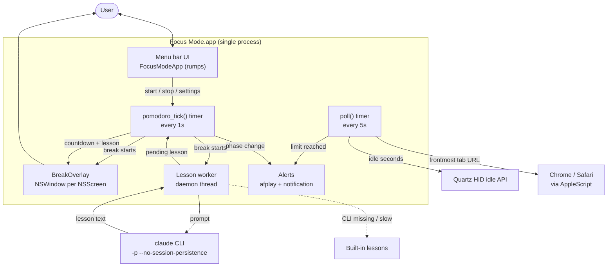
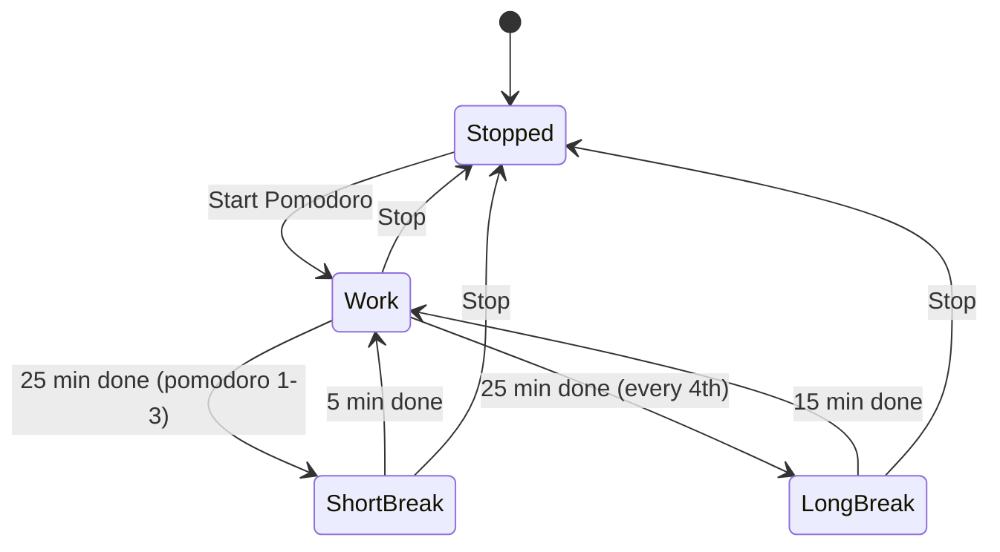
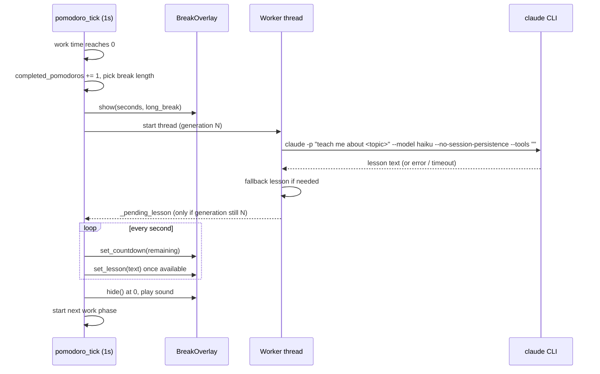

# Architecture

Focus Mode is a single-process macOS menu bar app (`focus_mode.py`) built on `rumps` and PyObjC.

## Components

## Pomodoro state machine

## Break sequence

## Key design decisions
- **One process, two timers.** A 5s `poll` handles idle/YouTube; a 1s `pomodoro_tick` drives phases. `poll` returns early during breaks.
- **UI only on the main thread.** The worker thread only writes `_pending_lesson`; the 1s tick applies it to the overlay.
- **Generation counter.** Stop or a new phase bumps `_lesson_generation`, so a slow lesson can't appear in a later break.
- **Overlay.** One borderless `NSWindow` per screen at `CGShieldingWindowLevel`, on all Spaces.
- **No chat history.** The lesson call uses `--no-session-persistence` and `--tools ""`, and runs from a temp directory.
- **Graceful fallback.** Missing CLI, error or 45s timeout shows one of the built-in lessons.

See [PROJECT.md](PROJECT.md) for the feature overview.
