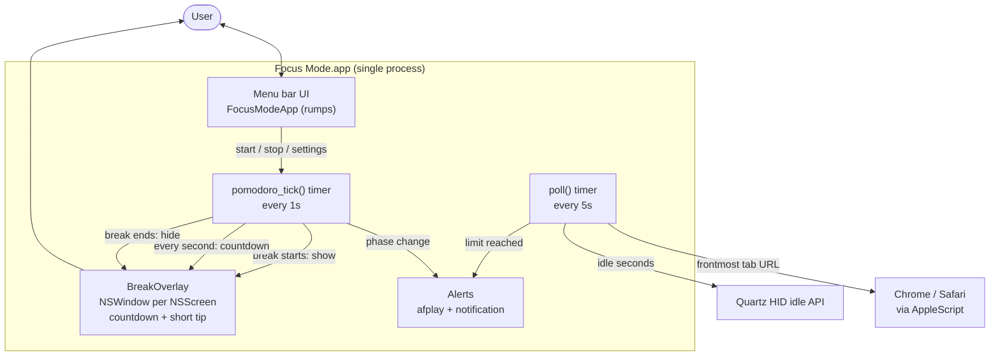
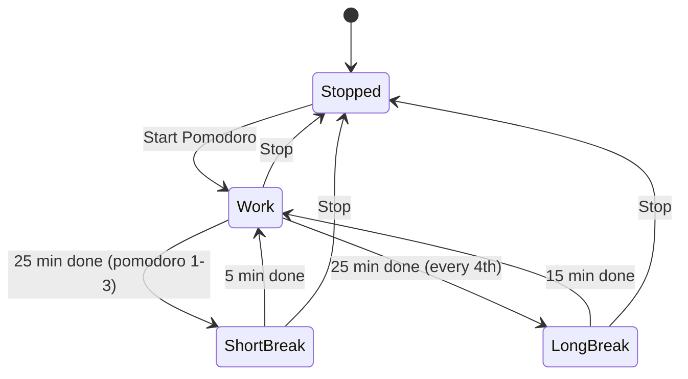
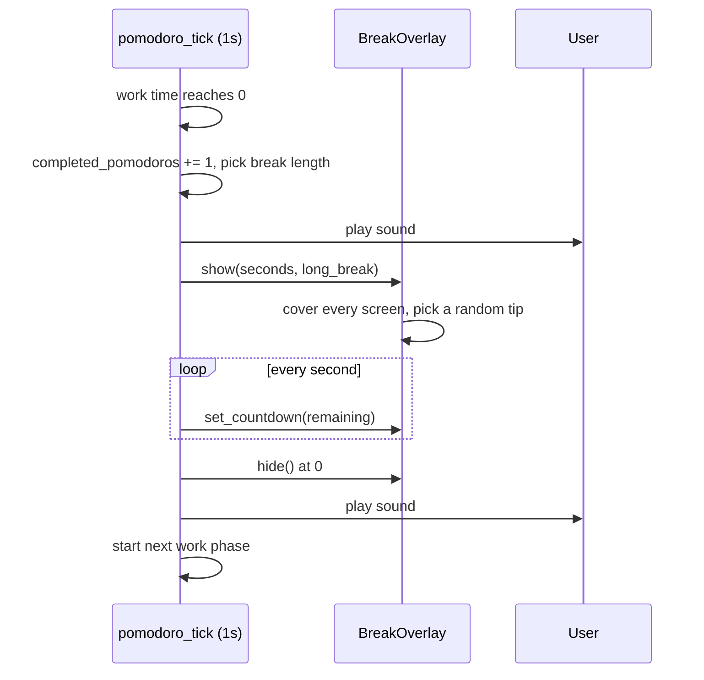

# Architecture

Focus Mode is a single-process macOS menu bar app (`focus_mode.py`) built on `rumps` and PyObjC.

## Components

## Pomodoro state machine

## Break sequence

## Key design decisions
- **One process, two timers.** A 5s `poll` handles idle/YouTube; a 1s `pomodoro_tick` drives phases. `poll` returns early during breaks.
- **Overlay.** One borderless `NSWindow` per screen at `CGShieldingWindowLevel`, on all Spaces.
- **Screen-free breaks.** The overlay shows only a countdown and one short tip. Nothing to read, so you actually look away.
- **No network, no external tools.** Everything runs locally, with no dependency on any CLI or service.

See [PROJECT.md](PROJECT.md) for the feature overview.
